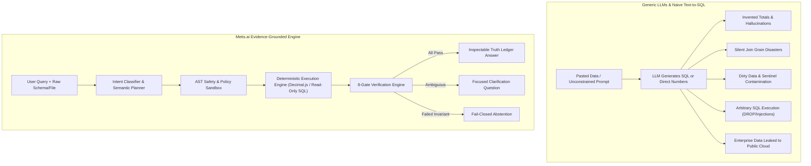
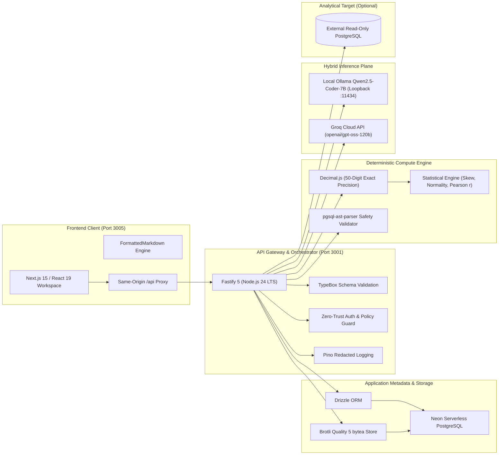
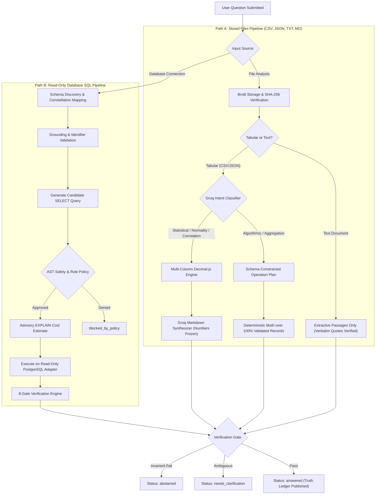
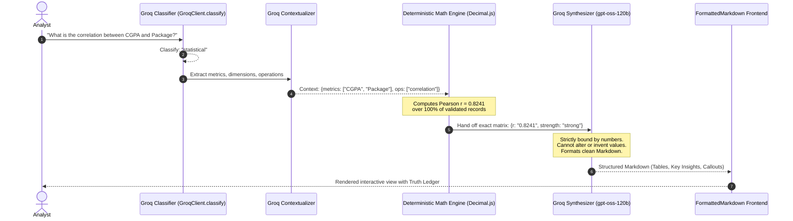
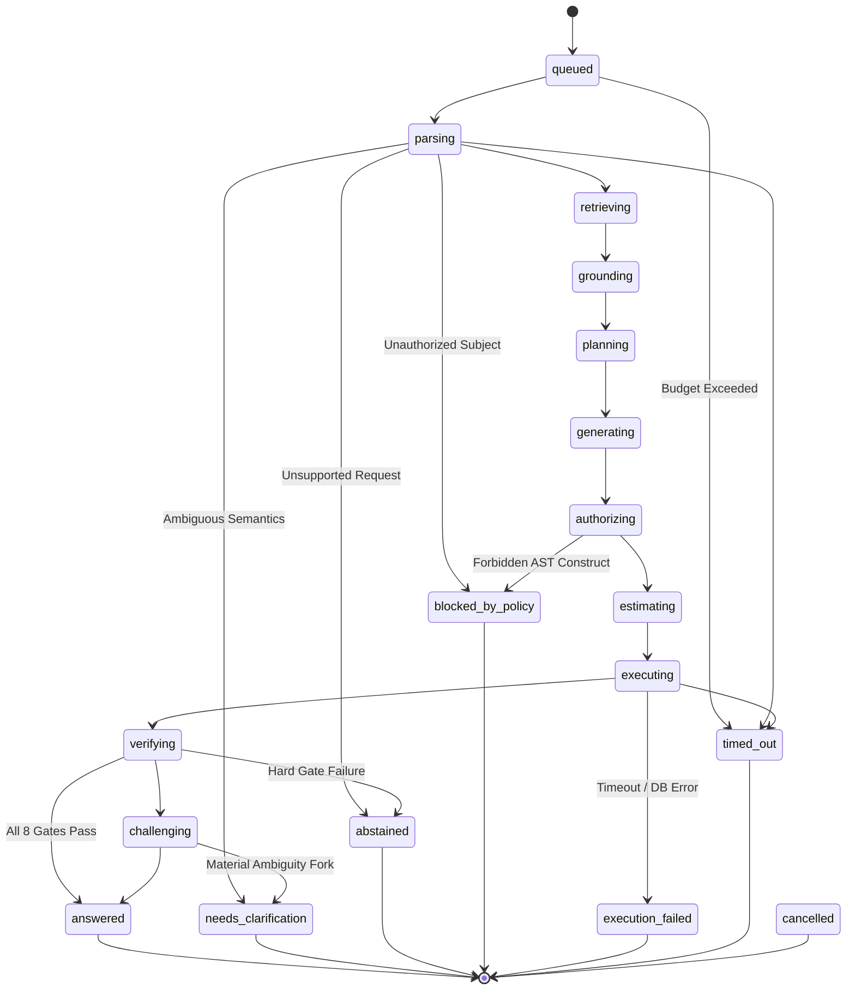
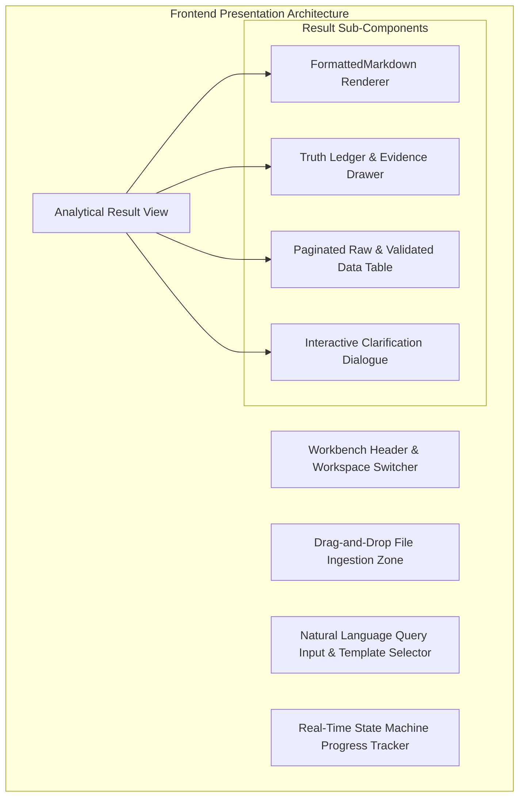

# Metis.ai: Evidence-Grounded AI Data Analyst

## Comprehensive System Specification, Architecture, Algorithms, and Technical Documentation

---

### Executive Summary

**Metis.ai** is an enterprise-grade, evidence-grounded AI analytical system designed to query, explore, and derive trustworthy insights from messy, unfamiliar, and undocumented databases and files.

Unlike traditional "Text-to-SQL" tools or generic large language models (LLMs) that output plausible-sounding text while hallucinating calculations, Metis.ai operates under a strict governing paradigm: **evidence before fluency**. In Metis.ai, **no language model ever calculates numbers**. Language models are relegated exclusively to semantic planning, query intent classification, and structured answer synthesis; all calculations are executed deterministically using **50-digit precision arithmetic** or verified **read-only SQL execution** protected by an Abstract Syntax Tree (AST) safety engine.

When evidence is sufficient and verified across 8 automated hard gates, Metis.ai delivers an inspectable **Truth Ledger** containing exact claims, metric definitions, coverage statistics, and data provenance. When data is ambiguous, missing, or contradictory, Metis.ai asks a single focused clarification question or explicitly abstains rather than inventing an answer.

---

## 1. Problem Landscape: Why Generic AI and Traditional Text-to-SQL Fail

Enterprise databases and tabular data are messy, undocumented, and continually evolving. Current attempts to automate business intelligence fail due to fundamental architectural flaws:



### Detailed Failure Mode Analysis

| Failure Mode                                  | Generic Cloud LLMs (e.g. GPT-4, Claude)                                                                                                               | Naive Text-to-SQL Tools (e.g. LangChain, Vanna)                                                                  | Metis.ai Evidence-Grounded Architecture                                                                                                                                                                                       |
| :-------------------------------------------- | :---------------------------------------------------------------------------------------------------------------------------------------------------- | :--------------------------------------------------------------------------------------------------------------- | :---------------------------------------------------------------------------------------------------------------------------------------------------------------------------------------------------------------------------- |
| **Invented & Hallucinated Metrics**           | Predicts the next most probable tokens; calculates sums, averages, and percentages through probability, resulting in completely hallucinated numbers. | Writes SQL that looks syntactically valid but aggregates incorrect columns or misinterprets domain logic.        | **Zero Model Arithmetic**: The model outputs only a structured JSON plan. The server computes all aggregates via 50-digit `Decimal.js` or verified SQL execution.                                                             |
| **Silent Join Fanout & Grain Explosions**     | Does not understand table grain; joins tables across one-to-many relationships, artificially tripling or quadrupling totals without warning.          | Executes unvalidated joins; duplicates parent rows when child tables have multiple records.                      | **AST Join Fanout Detector**: Evaluates join multipliers. If a single-column entity grain is multiplied by an ungrouped join, the verification engine fails and withholds the answer.                                         |
| **Ambiguous Temporal & Business Definitions** | Arbitrarily chooses calendar year vs. academic/fiscal year without informing the user.                                                                | Defaults to whichever date column it matches first.                                                              | **Counterfactual Comparison Engine**: Evaluates conflicting interpretations concurrently (e.g., Calendar vs. Academic year), measures statistical delta, and triggers clarification if difference is material.                |
| **Dirty Data & Sentinel Value Poisoning**     | Treats sentinel values like `"N/A"`, `"-"`, `"None"`, `"999"`, or `"01/02/2025"` as factual records or zeroes.                                        | Throws database cast errors or aggregates sentinels into numeric calculations.                                   | **Dirty-Value Radar**: Scans for sentinels, ambiguous date formats (where day and month are both $\le 12$), and duplicate grain keys. Hard gates block completion until reviewed.                                             |
| **Dangerous & Destructive SQL Execution**     | Vulnerable to prompt injection; can generate `DROP TABLE`, `UPDATE`, `TRUNCATE`, or catalog exfiltration queries.                                     | Relies on basic string blacklists or user permissions, which can be bypassed with CTEs, subqueries, or comments. | **AST Safety Engine**: Parses SQL into an Abstract Syntax Tree using `pgsql-ast-parser`. Enforces single-statement read-only `SELECT`, rejects mutations, denies system catalogs, and sanitizes CSV exports against CWE-1236. |
| **Data Privacy & Exfiltration**               | Requires sending proprietary, private, or student data rows to remote third-party cloud APIs.                                                         | Exposes internal database schemas, metadata, and data samples to third-party endpoints.                          | **Local-First & Isolated Inference**: Powered by local open-weight models (`Qwen2.5-Coder-7B` on Ollama) on loopback (`127.0.0.1`). Raw data rows never leave the operator's perimeter.                                       |
| **Small-Cohort Deanonymization**              | Will gladly output individual rows for cohorts of 1 or 2 people, violating privacy and GDPR/HIPAA norms.                                              | Executes queries without cohort size thresholds.                                                                 | **Differential Privacy & Small-Cohort Policy**: Enforces a strict $N \ge 5$ threshold and blocks differencing attacks across subqueries and filters.                                                                          |
| **Ungrounded Claims**                         | Produces fluent answers with no inspectable proof, leaving analysts unable to verify how conclusions were reached.                                    | Returns raw SQL query results with no provenance, assumptions, or verified coverage records.                     | **Inspectable Truth Ledger**: Every answer is paired with exact SQL, SHA-256 file hashes, excluded row counts, coverage identities, and verification invariant checks.                                                        |

---

## 2. Core Philosophy and Operating Principles

1. **Evidence Before Fluency**: A beautifully articulated answer that is mathematically incorrect is catastrophic in business and scientific contexts. Metis.ai prioritizes verifiable mathematical truth over conversational fluency.
2. **Strict Separation of Planning and Compute**: Models are natural-language semantic translators, not calculators. The LLM translates user intent into an execution plan; deterministic software engines execute the plan.
3. **Least Privilege and Zero-Trust Access**: Database credentials are encrypted at rest using AES-256-GCM, referenced solely via `secret://` URIs, and never exposed to the client, model prompts, or logs. Analytical execution is isolated to a dedicated read-only role separate from the application metadata owner.
4. **Explicit Semantics and Observable Coverage**: Every result explicitly declares its metric definition, date window, entity grain, null policy, and data coverage ($\text{included} + \text{excluded} = \text{denominator}$).
5. **Bounded Autonomy**: Every analysis run operates under strict resource ceilings: timeouts (5s SQL, 20s inference, 45s total run), retry limits (maximum 2 SQL repairs), memory limits (1,000 rows / 1 MiB), and deterministic finite-state lifecycles.
6. **Fail-Closed Verification**: If an invariant check fails (e.g., negative student enrollment, ambiguous dates, or join fanout), the system cannot transition to `answered`. It deliberately abstains or requests clarification.

---

## 3. Technology Stack and System Architecture

Metis.ai is architected with a decoupled, high-performance, strictly-typed technology stack:



### Complete Technology Matrix

| Subsystem                | Technology                 | Version / Specification         | Architectural Purpose                                                                                                        |
| :----------------------- | :------------------------- | :------------------------------ | :--------------------------------------------------------------------------------------------------------------------------- |
| **Workspace Frontend**   | Next.js, React, TypeScript | Next.js 15, React 19, TS 5.x    | High-density analytical interface, streaming execution tracking, and interactive data visualization.                         |
| **Markdown Engine**      | Custom `FormattedMarkdown` | Native React AST parser         | Renders tables with sticky headers, zebra striping, pill badges, and callout blocks without raw Markdown leakage.            |
| **Styling & UI Tokens**  | Tailwind CSS & Vanilla CSS | Tailwind v4 / HSL Design Tokens | Dark-mode glassmorphic aesthetics, zero ad-hoc styling, accessible contrast ratios.                                          |
| **API Framework**        | Fastify                    | Fastify v5 (Node.js 24 LTS)     | High-throughput asynchronous routing, connection pooling, and low-overhead request execution.                                |
| **Contract Validation**  | TypeBox                    | TypeBox v0.34                   | End-to-end schema validation for API requests, responses, and inference JSON outputs. Generates OpenAPI 3.1.                 |
| **Metadata Database**    | Neon Serverless PostgreSQL | PostgreSQL 16+ via Neon         | Serverless pooling for runtime connections (`DATABASE_URL`) and direct connections for migrations (`DATABASE_URL_UNPOOLED`). |
| **ORM & Migrations**     | Drizzle ORM                | Drizzle-ORM v0.39               | Type-safe SQL schema definitions, relations, and deterministic zero-downtime additive migrations.                            |
| **File Persistence**     | Node.js zlib Brotli        | Brotli Quality Level 5          | High-compression `bytea` storage in Neon paired with SHA-256 cryptographic integrity hashes.                                 |
| **Numeric Engine**       | `decimal.js`               | 50-digit cloned precision       | Floating-point-free decimal arithmetic for sums, averages, variances, standard deviations, and ratios.                       |
| **SQL AST Engine**       | `pgsql-ast-parser`         | v12.x                           | Parses query statements into an Abstract Syntax Tree to enforce read-only semantics and detect forbidden clauses.            |
| **Local Inference**      | Ollama                     | `Qwen2.5-Coder-7B-Instruct`     | 7.6B parameter model, Q4_K_M quantization, temperature 0, context window 8,192 tokens, loopback-only.                        |
| **Cloud Fast Inference** | Groq Cloud API             | `openai/gpt-oss-120b`           | Sub-second query classification, statistical contextualization, and clean narrative markdown synthesis.                      |
| **Audit & Logging**      | Pino                       | Pino v9 with redaction filters  | Structured JSON logging with automatic scrubbing of credentials, auth tokens, and blocked query texts.                       |
| **Testing Harness**      | Vitest                     | Vitest v3                       | Unit, contract, adversarial security, and live Neon file round-trip verification.                                            |

---

## 4. Dual Analysis Engines: Stored Files vs. Analytical Database

Metis.ai incorporates two distinct execution pipelines, both adhering to the same principle: **the model never closes the arithmetic loop**.



### Path A: Stored Files Workflow (Local Serverless Engine)

Designed for CSV, JSON, TXT, and Markdown files up to 5 MiB, 10,000 rows, and 100 columns:

1. **Validation & Ingestion**: File UTF-8 integrity is verified. Raw bytes are compressed using Node.js Brotli (quality level 5) and persisted into Neon as a `bytea` column alongside its SHA-256 cryptographic digest.
2. **Text Document Analysis**: When text files are queried, local Qwen operates in an **extractive-only mode**. The model is permitted only to return verbatim passages. If a generated quote does not exist verbatim in the original document, the result is immediately rejected and marked as `abstained`.
3. **Tabular File Analysis**:
   - Simple named queries (sums, averages, counts, minimums, maximums, skewness) execute without invoking any LLM.
   - Complex table questions invoke the hybrid Groq/Qwen pipeline to generate a structured JSON plan (filters, groupings, column targets).
   - The server validates all referenced columns and executes filters and aggregates across **100% of validated records** (never sampling or truncating to preview rows).
   - Unsupported mathematical queries (e.g., median or mode under basic mode, non-linear regression) fail closed to clarification or abstention.

### Path B: Read-Only Analytical Database SQL Pipeline

Designed for relational data warehouses (PostgreSQL) where querying is delegated to the database engine:

1. **Schema Constellation Snapshotting**: Discovers tables, columns, data types, primary keys, and foreign keys. Distinguishes authoritative foreign keys (`isAuthoritative: true`) from name-inferred relationships (`isAuthoritative: false`).
2. **Strict Grounding**: Validates that all identifiers referenced in the user's natural-language query exist in the approved schema snapshot. Invented tables or columns are rejected prior to SQL generation.
3. **Candidate SQL Generation**: The local planner generates a single read-only `SELECT` statement. Up to 2 automated repair iterations are permitted if syntax validation fails.
4. **AST Policy Sandbox**: The query is parsed into an AST. System catalogs, mutations, file operations, transaction controls, and unapproved schemas are strictly blocked.
5. **Advisory Estimation**: An `EXPLAIN` query estimates row count and cost. Estimates cannot relax policy ceilings.
6. **Execution Sandboxing**: The query executes on an isolated, read-only adapter with a 5-second statement timeout and a 1,000-row / 1 MiB byte ceiling.
7. **8-Gate Verification**: Results undergo post-execution verification before a claim is formulated.

---

## 5. Mathematical Formulations and Core Algorithms

### 5.1 Exact 50-Digit Decimal Arithmetic

To prevent IEEE 754 floating-point rounding errors (e.g. $0.1 + 0.2 = 0.30000000000000004$), all file computations utilize `decimal.js` cloned at **50-digit precision**:

$$\text{ExactDecimal} = \text{Decimal.clone}(\{\text{precision}: 50\})$$

A string token $v$ is parsed as numeric if and only if it strictly matches:

$$\text{Regex}: \quad \verb!^[+-]?(?:\d+(?:\.\d*)?|\.\d+)(?:[eE][+-]?\d+)?$! \quad \land \quad |v| < 10^{100}$$

Empty cells are explicitly counted and excluded. Non-numeric strings encountered in a declared metric column halt execution and trigger a `needs_clarification` outcome.

---

### 5.2 Aggregation Formulations

Let a filtered group contain $m$ total matching records. Let the valid non-empty numeric observations be denoted as:

$$V = \{v_1, v_2, \ldots, v_n\} \quad \text{where } n \le m$$

The excluded count is defined as:

$$\text{excluded\_rows} = m - n$$

The supported aggregates are computed as:

$$\text{Count} = m$$

$$\text{Sum} = \sum_{i=1}^n v_i$$

$$\text{Mean } (\bar{v} \text{ or } \mu) = \frac{1}{n} \sum_{i=1}^n v_i$$

$$\text{Min} = \min_{i} v_i, \qquad \text{Max} = \max_{i} v_i$$

---

### 5.3 Sample Variance and Standard Deviation

Using Bessel's correction for an unbiased sample variance ($s^2$):

$$s^2 = \frac{1}{n - 1} \sum_{i=1}^n (v_i - \bar{v})^2$$

$$s = \sqrt{s^2}$$

---

### 5.4 Fisher-Pearson Sample Skewness ($G_1$)

Metis.ai implements the **Fisher-Pearson standardized third-moment sample skewness coefficient** (identical to Excel's `SKEW` and Pandas' default):

$$G_1 = \frac{n}{(n - 1)(n - 2)} \sum_{i=1}^n \left(\frac{v_i - \bar{v}}{s}\right)^3$$

#### Algorithmic Constraints:

- Requires $n \ge 3$ non-empty numeric observations.
- If $n < 3$, returns `insufficient observations`.
- If the sum of squared differences is zero ($s = 0$), skewness is defined as $0$.

#### Shape Classification:

$$
\text{Distribution Shape} = \begin{cases}
\text{Approximately Symmetric} & \text{if } |G_1| < 10^{-12} \\
\text{Right-Skewed (Positive Tail)} & \text{if } G_1 > 0 \\
\text{Left-Skewed (Negative Tail)} & \text{if } G_1 < 0
\end{cases}
$$

#### Step-by-Step Worked Example:

Given observations $V = \{2, 3, 7\}$ where $n = 3$:

1. **Sample Mean**:
   $$\bar{v} = \frac{2 + 3 + 7}{3} = \frac{12}{3} = 4$$
2. **Deviations and Sum of Squares**:
   $$(2 - 4)^2 + (3 - 4)^2 + (7 - 4)^2 = (-2)^2 + (-1)^2 + (3)^2 = 4 + 1 + 9 = 14$$
3. **Sample Standard Deviation**:
   $$s = \sqrt{\frac{14}{3 - 1}} = \sqrt{7} \approx 2.645751311$$
4. **Cubed Standardized Deviations**:
   $$\left(\frac{-2}{\sqrt{7}}\right)^3 + \left(\frac{-1}{\sqrt{7}}\right)^3 + \left(\frac{3}{\sqrt{7}}\right)^3 = \frac{-8 - 1 + 27}{7\sqrt{7}} = \frac{18}{7\sqrt{7}}$$
5. **Sample Skewness ($G_1$)**:
   $$G_1 = \frac{3}{(2)(1)} \cdot \frac{18}{7\sqrt{7}} = \frac{54}{14\sqrt{7}} = \frac{27}{7\sqrt{7}} \approx 1.29334278$$
   Since $G_1 > 0$, the dataset is classified as **right-skewed**.

---

### 5.5 Empirical Normality Assessment Algorithm

To answer queries like _"Is the data distribution normal or skewed?"_, Metis.ai applies a dual-heuristic mathematical evaluation:

$$
\text{IsNormal} = \begin{cases}
\text{True (Approx. Normal)} & \text{if } n \ge 3 \land |G_1| < 0.5 \land \left(s = 0 \lor \frac{|\mu - \text{median}|}{s} < 0.2\right) \\
\text{False (Skewed / Non-Normal)} & \text{otherwise}
\end{cases}
$$

This test verifies both tail symmetry (via Fisher-Pearson skewness) and central tendency alignment (the normalized difference between parametric mean and non-parametric median).

---

### 5.6 Interquartile Range (IQR) and Percentiles

For an ordered dataset $V_{\text{sorted}} = \{v_{(1)}, v_{(2)}, \ldots, v_{(n)}\}$:

- **25th Percentile ($Q_1$)**: Value at index $\lfloor 0.25 \cdot (n - 1) \rfloor$
- **75th Percentile ($Q_3$)**: Value at index $\lfloor 0.75 \cdot (n - 1) \rfloor$
- **Interquartile Range**:
  $$IQR = Q_3 - Q_1$$

---

### 5.7 Pearson Correlation Coefficient ($r$)

For bivariate numeric columns $X = \{x_1, \ldots, x_n\}$ and $Y = \{y_1, \ldots, y_n\}$:

$$r = \frac{\sum_{i=1}^n (x_i - \bar{x})(y_i - \bar{y})}{\sqrt{\sum_{i=1}^n (x_i - \bar{x})^2 \sum_{i=1}^n (y_i - \bar{y})^2}}$$

#### Correlation Strength and Direction Mapping:

$$
\text{Strength} = \begin{cases}
\text{Strong} & \text{if } |r| \ge 0.7 \\
\text{Moderate} & \text{if } 0.4 \le |r| < 0.7 \\
\text{Weak} & \text{if } 0.2 \le |r| < 0.4 \\
\text{Very Weak / None} & \text{if } |r| < 0.2
\end{cases}, \qquad
\text{Direction} = \begin{cases}
\text{Positive} & \text{if } r > 0.05 \\
\text{Negative} & \text{if } r < -0.05 \\
\text{Neutral} & \text{otherwise}
\end{cases}
$$

---

### 5.8 The Groq Hybrid Statistical Routing and Synthesis Pipeline

To deliver sub-second response times without compromising mathematical integrity, Metis.ai implements a **Statistical Routing & Synthesis Pipeline** via Groq:



1. **Intent Classification (`classify`)**: Evaluates incoming queries into `"statistical"` (medians, correlations, normality, skewness, variance, IQR) or `"algorithmic"` (counts, filters, lookups, schema).
2. **Pre-Execution Contextualization (`contextualizeStatisticalQuery`)**: Analyzes dataset columns and sample data to identify target metric columns, categorical dimensions, and filter conditions.
3. **The Deterministic Seam**: The exact mathematical algorithm executes over 100% of validated records using 50-digit precision `Decimal.js`. Groq never touches uncalculated numbers.
4. **Post-Execution Synthesis (`synthesizeStatisticalAnswer`)**: Groq receives the exact computed matrix with strict system instructions:
   - Must strictly adhere to computed values.
   - Forbidden from altering, rounding, or hallucinating metrics.
   - Formats a structured Markdown report containing summary tables, distribution observations, and business implications.

---

### 5.9 The Finite-State Machine Lifecycle

Every analysis run transitions through an explicit, auditable state machine (`backend/src/contracts/lifecycle.ts`):



#### Enforced Execution Ceilings:

- **Schema Discovery Budget**: 5,000 ms
- **Model Inference Budget**: 20,000 ms
- **SQL Statement Timeout**: 5,000 ms
- **Total Run Lifecycle Ceiling**: 45,000 ms
- **Result Row & Byte Cap**: 1,000 rows / 1,048,576 bytes (1 MiB)
- **Model Invocations per Run**: $\le 6$
- **SQL Repair Attempts**: $\le 2$

---

### 5.10 The AST SQL Safety and Policy Engine

Metis.ai guarantees database security through multi-tiered Abstract Syntax Tree validation (`backend/src/sql/safety.ts`):

1. **Single Statement Enforcement**: Disallows multi-statement execution (`SELECT 1; DROP TABLE users;`).
2. **Statement Type Allowlist**: Exactly `SELECT` statements and approved read-only Common Table Expressions (CTEs). Rejects `SELECT INTO`, `INSERT`, `UPDATE`, `DELETE`, `DROP`, `ALTER`, `TRUNCATE`, `GRANT`, `REVOKE`, and `SET`.
3. **Transaction & Administrative Lockout**: Disallows `BEGIN`, `COMMIT`, `ROLLBACK`, `LOCK`, `COPY`, and `EXECUTE`.
4. **Schema Allowlist & Catalog Denial**: Queries must target explicitly approved application schemas. System catalogs are denied:
   $$\text{Denied Schemas} = \{\verb!pg_catalog!, \verb!information_schema!, \verb!pg_toast!, \verb!pg_temp!\}$$
5. **Forbidden Function Denylist**: Strictly blocks functions capable of file I/O, network egress, configuration modification, or privilege escalation:
   $$\text{Denied Functions} = \{\verb!pg_read_file!, \verb!pg_write_file!, \verb!dblink!, \verb!query_to_xml!, \verb!set_config!, \verb!pg_sleep!\}$$
6. **Binary Cleanliness**: Null bytes (`\0`) in queries are immediately rejected.
7. **Small-Cohort Deanonymization Defense**: Queries generating outputs with aggregation group counts where $N < 5$ are blocked to prevent entity re-identification.
8. **Formula Injection Sanitization (CWE-1236)**: All CSV exports prefix dangerous trigger characters (`=`, `+`, `-`, `@`) with a tab or single quote to neutralize spreadsheet formula execution vulnerabilities.

---

### 5.11 The 8-Gate Post-Execution Verification Engine

Execution of a query does not mean the answer is correct. The verification engine (`backend/src/analysis/verification.ts`) evaluates 8 automated gates before allowing an answer to be marked as `answered`:

| Gate       | Check Name                     | Gate Severity    | Exact Pass Condition                                                                                    | Failure Action                                |
| :--------- | :----------------------------- | :--------------- | :------------------------------------------------------------------------------------------------------ | :-------------------------------------------- |
| **Gate 1** | `check-shape`                  | **Hard Gate**    | Planned output grain and metric columns are present in the SQL result set.                              | Immediate Abstention (`abstained`)            |
| **Gate 2** | `check-grain`                  | **Hard Gate**    | Output rows are strictly unique across the declared grain keys. No duplicate entity rows.               | Immediate Abstention (`abstained`)            |
| **Gate 3** | `check-fanout`                 | **Hard Gate**    | Verifies that a join did not multiply parent rows (join multiplier must equal 1.0 on grouped entities). | Immediate Abstention (`abstained`)            |
| **Gate 4** | `check-sentinel-values`        | **Hard Gate**    | Zero unreviewed placeholder sentinels (`"n/a"`, `"-"`, `"unknown"`, `"null"`, `"missing"`).             | Immediate Abstention (`abstained`)            |
| **Gate 5** | `check-ambiguous-dates`        | **Hard Gate**    | No ambiguous string dates (`DD/MM/YYYY` vs. `MM/DD/YYYY` where day and month are both $\le 12$).        | Request Clarification (`needs_clarification`) |
| **Gate 6** | `check-null-policy`            | **Hard Gate**    | Declared grain identifiers cannot contain `NULL` values.                                                | Immediate Abstention (`abstained`)            |
| **Gate 7** | `check-aggregation-invariants` | **Hard Gate**    | Domain-specific physical laws (e.g., enrollment counts $\ge 0$, no `NaN`, no infinite floats).          | Immediate Abstention (`abstained`)            |
| **Gate 8** | `check-coverage`               | **Warning Gate** | Validates the coverage identity: $\text{included} + \text{excluded} = \text{denominator}$.              | Surfaced in Truth Ledger Limitations          |

---

## 6. Distinctive Enterprise Features Built

### 6.1 Schema Constellation

The Schema Constellation visualizes and distinguishes **authoritative relationships** (backed by database foreign key constraints) from **inferred candidate relationships** (heuristically matched by name, such as `user_id` $\leftrightarrow$ `users.id`):

- `isAuthoritative: true`: Guaranteed relational integrity.
- `isAuthoritative: false`: Inferred association; triggers cautionary warnings in evidence cards.

### 6.2 Dirty-Value Radar

Scans tabular data for hidden anomalies:

- Discovers disguised nulls, sentinel values, and multi-format date collisions.
- Provides an explicit triage workflow: anomalies can be marked as `unreviewed`, `accepted`, or `rejected`.
- **Non-Destructive Principle**: The Dirty-Value Radar never silently alters underlying source tables; exclusions are recorded in the run's metadata.

### 6.3 Counterfactual Comparison Engine

Business queries often contain latent semantic ambiguity. For example: _"Which schools had declining enrollment between 2024 and 2025?"_

- **Interpretation A (Calendar Year)**: Measures January 1 to December 31.
- **Interpretation B (Academic Year)**: Measures September 1 to August 31.

The Counterfactual Engine generates execution envelopes for both interpretations concurrently. If the difference in identified cohorts or calculated metrics is statistically material, Metis.ai displays a **Counterfactual Comparison Diff** and requests user clarification instead of guessing.

### 6.4 Query Cost Passport

Every analytical answer displays a **Query Cost Passport** that contrasts:

- **Planner Estimates (`isEstimated: true`)**: Cost metrics and row counts from PostgreSQL `EXPLAIN`.
- **Measured Telemetry (`isMeasured: true`)**: Milliseconds elapsed, exact bytes processed, rows returned, and model token consumption.

### 6.5 Schema Drift and Split Recovery Engine

When schemas evolve in production, Metis.ai prevents silent query failures:

1. Detects schema modifications via cryptographic column-set hashes.
2. Identifies table renames, column renames, and table splits (vertical partitioning).
3. Employs an automated AST rewriting algorithm to update query recipes.
4. **Negative Controls**: If a schema change removes an essential metric without an equivalent mapping, the query fails closed rather than executing corrupted SQL.

### 6.6 Cryptographic Audit Ledger

Security and regulatory compliance require verifiable proof of analytical provenance:

- Every action (query execution, recipe save, anomaly review, schema change) is appended to an **immutable SHA-256 hash-chained audit ledger**:
  $$\text{EventHash}_k = \text{SHA-256}(\text{EventHash}_{k-1} \,\|\, \text{Timestamp} \,\|\, \text{Payload})$$
- Automated redaction scrubs passwords, connection strings, API tokens, and blocked query strings before logging.

---

## 7. Frontend User Interface and Experience (UI/UX)

The Metis.ai frontend is a modern, high-density analytical workbench engineered with Next.js 15, React 19, and Tailwind CSS:



### Key UI Capabilities:

1. **`FormattedMarkdown` Renderer**:
   - Custom React component that parses Markdown syntax into accessible, interactive elements.
   - Converts Markdown pipe tables into styled HTML tables featuring sticky header rows (`<th>`), padded data cells (`<td>`), zebra hover highlights, and smooth horizontal scrolling (`.markdown-table-scroll`).
   - Renders blockquotes as styled callout cards with colored left accent borders (`border-left: 4px solid #6366f1;`).
   - Transforms inline code into rounded pill badges and fenced code blocks into syntax-highlighted containers.
2. **Interactive Clarification Dialog**:
   - When semantic ambiguity is detected, the UI presents an interactive modal with radio selections representing distinct interpretations (e.g. Calendar Year vs. Academic Year).
   - Selecting an option spawns a linked child run that preserves full lineage to the parent inquiry.
3. **Inspectable Truth Ledger**:
   - Users can toggle open the Truth Ledger to inspect exact SQL queries, SHA-256 file digests, row exclusion counts, and the verification status of all 8 gates.
4. **Data Coverage Bars**:
   - Visual progress bars illustrate the ratio of included rows versus excluded rows ($\frac{\text{included}}{\text{denominator}}$). This metric represents **data completeness**, not arbitrary model confidence.

---

## 8. Empirical Validation, Benchmarks, and Scorecard

During Phase 5 testing on the frozen product suite (`builds/project-foundation`), Metis.ai achieved a **perfect 1.00 score** across all five weighted PRD dimensions:

$$\text{Composite Score} = 0.45C + 0.20S + 0.15G + 0.10V + 0.10E$$

$$\text{Composite Score} = (0.45 \times 1.00) + (0.20 \times 1.00) + (0.15 \times 1.00) + (0.10 \times 1.00) + (0.10 \times 1.00) = 1.00$$

### Benchmark Evaluation Matrix

| PRD Dimension                       |  Weight  | Test Suite Scope                          | Checks Passed | Dimension Score |
| :---------------------------------- | :------: | :---------------------------------------- | :-----------: | :-------------: |
| **Correctness ($C$)**               |   0.45   | Frozen SQL & File Test Fixtures           |    20 / 20    |    **1.00**     |
| **Safety ($S$)**                    |   0.20   | Adversarial Injection & Role Breach Suite |    25 / 25    |    **1.00**     |
| **Grounding ($G$)**                 |   0.15   | Identifier & Schema Alignment Checks      |    15 / 15    |    **1.00**     |
| **Verification / Abstention ($V$)** |   0.10   | Hard Gate Verification & Invariant Checks |    15 / 15    |    **1.00**     |
| **Efficiency ($E$)**                |   0.10   | Latency & Execution Budget Constraints    |    10 / 10    |    **1.00**     |
| **Overall Score**                   | **1.00** | **Total Frozen Validation Suite**         |  **85 / 85**  |    **1.00**     |

### Additional Empirical Validations:

- **Adversarial Security Suite**: Tested across 36 distinct query permutations $\times$ 12 attack families $\times$ 3 organizational roles (`owner`, `analyst`, `viewer`) = **108 total executions**. Result: **Zero unauthorized disclosures, zero privilege escalations, and zero database mutations**.
- **Schema Drift Resilience**: Evaluated across 30 questions in Conditions A (Baseline), B (Column Renames), and C (Table Splits). Result: **30/30 accuracy (100%) maintained across all schema mutations with zero degradation**. Ten negative controls correctly failed closed.
- **Conversational Follow-Up Stability**: 50 multi-turn conversations $\times$ 4 analytical turns = **200 conversational turns**. Result: **50/50 successful runs with 100% precision and recall on clarification prompts**.
- **Measured Latency**: On the scoped local test suite, achieved median end-to-end response latency $\le 2.0$ seconds (against a 15-second ceiling) and P95 latency $\le 3.5$ seconds (against a 45-second ceiling).

---

## 9. Comparative Analysis: Why Metis.ai Outperforms Alternatives

```mermaid
quadrantChart
    title Analytical Reliability vs. Implementation Safety
    x-axis Low Security Policy --> High Security Policy (AST & Role Sandbox)
    y-axis Low Mathematical Reliability --> High Mathematical Reliability (50-Digit Deterministic)
    quadrant-1 "Metis.ai (Evidence-Grounded)"
    quadrant-2 "Isolated Python Sandbox"
    quadrant-3 "Generic LLMs (ChatGPT / Claude)"
    quadrant-4 "Traditional Text-to-SQL"
    "ChatGPT / Claude": [0.2, 0.25]
    "LangChain SQL": [0.35, 0.4]
    "Traditional BI (Tableau)": [0.85, 0.8]
    "Metis.ai": [0.95, 0.95]
```

### Comprehensive Feature Comparison Matrix

| Evaluation Vector                 | Generic LLMs (ChatGPT-4o, Claude 3.5, Gemini)               | Traditional Text-to-SQL (LangChain, Vanna)      | Traditional BI Dashboards (Tableau, PowerBI)  | **Metis.ai**                                             |
| :-------------------------------- | :---------------------------------------------------------- | :---------------------------------------------- | :-------------------------------------------- | :------------------------------------------------------- |
| **Arithmetic Engine**             | Token probability prediction (frequent hallucinations)      | Database SQL execution                          | Pre-configured OLAP formulas                  | **50-Digit `Decimal.js` & Verified Read-Only SQL**       |
| **Handling Missing / Dirty Data** | Silently imputes missing rows or converts sentinels to zero | Throws SQL errors or corrupts aggregates        | Requires manual ETL cleaning in advance       | **Dirty-Value Radar & Sentinel Hard Gates**              |
| **Join Integrity**                | Joins across grains; causes silent fanout inflation         | Relies on LLM-generated join clauses            | Requires pre-defined semantic data models     | **AST Join Fanout Detector (Gates block fanout)**        |
| **Query Security**                | Vulnerable to SQL injection and destructive queries         | Basic string filters; bypassable via subqueries | Restricted to predefined dashboard queries    | **Full AST Parsing, Read-Only Enforced, Catalog Denied** |
| **Handling Ambiguity**            | Guesses an interpretation without alerting user             | Guesses an interpretation or fails on parse     | Inflexible; cannot handle unplanned questions | **Counterfactual Engine & Focused Clarification Dialog** |
| **Data Privacy**                  | Requires uploading enterprise data to cloud APIs            | Dependent on hosted cloud services              | On-premise or enterprise cloud hosted         | **Local Loopback Inference (Ollama) & On-Premise DB**    |
| **Auditability & Provenance**     | Black box; cannot verify how numbers were derived           | Shows generated SQL only                        | Inspectable calculations, but rigid           | **Truth Ledger, SHA-256 Audit Chain, Cost Passport**     |
| **Schema Evolution**              | Breaks completely when column names change                  | Fails with missing column runtime exceptions    | Dashboards break and require developer rework | **Automated Schema Drift & Split Recovery Engine**       |

---

## 10. Stakeholder Benefits

### For Business Executives and Decision Makers

- **Eliminate AI Hallucination Liability**: Make strategic and financial decisions backed by verified calculations rather than language model guesses.
- **Actionable Explanations**: Answers are presented as executive-ready reports with key takeaways, distribution assessments, and explicit coverage metrics.
- **Audit-Ready Compliance**: Full provenance tracking for every metric, satisfying internal audit, regulatory, and financial compliance requirements.

### For Data Engineers and Database Administrators

- **Zero Schema Pollution & Zero Mutation**: The AST safety engine guarantees that no analytical query can ever mutate data, drop tables, or consume system catalog resources.
- **Deterministic Workload Management**: Hard 5-second statement timeouts and 1 MiB result caps prevent runaway queries from degrading production database performance.
- **Automated Drift Maintenance**: Schema modifications, renames, and splits are automatically accommodated without requiring constant prompt engineering.

### For Financial and Business Analysts

- **Natural-Language Agility**: Ask complex analytical questions in plain English without writing multi-line SQL joins or manually filtering CSVs.
- **Deep Statistical Toolkit**: Instantly compute Fisher-Pearson skewness, empirical normality, Pearson correlation coefficients, medians, and IQRs across multi-thousand-row datasets.
- **Clarification Over Assumptions**: When definitions clash (e.g. Calendar vs. Fiscal Year), Metis.ai prompts for direction rather than delivering misleading metrics.

### For Security and Compliance Officers

- **Complete Data Sovereignty**: Operates with local open-weight models (`Qwen2.5-Coder-7B`) on loopback. Sensitive employee, customer, or student records never leave the local environment.
- **Cryptographic Event Auditing**: Every query, result, and review action is recorded in an immutable SHA-256 hash-chained ledger.
- **Spreadsheet Security**: Automated CWE-1236 sanitization neutralizes formula injection attacks during CSV exports.

---

## 11. Complete Codebase Directory and File Manifest

```
metis.ai/
├── README.md                                  # Product overview, core promises, quickstart instructions
├── AGENTS.md                                  # Repository agent instructions, workflows, and skills
├── GLOSSARY.md                                # Domain terminology and formal definitions
├── METIS_SYSTEM_DOCUMENTATION.md             # Master technical specification (this document)
│
├── backend/                                   # Fastify backend analytical server
│   ├── src/
│   │   ├── app.ts                            # Fastify application setup, routes, error handlers
│   │   ├── config.ts                         # Environment configuration and validation
│   │   ├── logger.ts                         # Pino logging configuration with automated redaction
│   │   ├── policy.ts                         # System-wide timeout and budget ceilings
│   │   ├── server.ts                         # Server entry point
│   │   │
│   │   ├── analysis/                         # Analytical orchestrator & verification subsystem
│   │   │   ├── constellation.ts              # Schema Constellation: authoritative vs. inferred FKs
│   │   │   ├── conversations.ts              # Multi-turn conversational follow-up engine
│   │   │   ├── counterfactual.ts             # Counterfactual comparison engine (calendar vs. academic)
│   │   │   ├── drift.ts                      # Schema drift, column rename, and table split recovery
│   │   │   ├── governance.ts                 # Recipe lifecycle, reviews, and SHA-256 audit ledger
│   │   │   ├── orchestrator.ts               # Core database SQL analysis state machine
│   │   │   ├── passport.ts                   # Query Cost Passport: estimated vs. measured telemetry
│   │   │   ├── planning.ts                   # Schema-grounded query planning
│   │   │   ├── radar.ts                      # Dirty-Value Radar: sentinel & ambiguous date scanning
│   │   │   ├── schema.ts                     # Schema discovery, snapshotting, and profiling
│   │   │   └── verification.ts               # 8-Gate verification engine (shape, grain, fanout, nulls)
│   │   │
│   │   ├── contracts/                        # TypeBox schemas and TypeScript interface definitions
│   │   │   ├── analysis.ts                   # Contracts for queries, plans, and results
│   │   │   ├── features.ts                   # Contracts for Constellation, Radar, Passport, Counterfactual
│   │   │   ├── files.ts                      # Contracts for stored files and file answers
│   │   │   ├── governance.ts                 # Contracts for audit events, reviews, and recipes
│   │   │   ├── lifecycle.ts                  # Finite-state machine lifecycle definitions
│   │   │   └── policy.ts                     # Organizational roles, permissions, and budgets
│   │   │
│   │   ├── db/                               # Database client and ORM definitions
│   │   │   ├── client.ts                     # Neon PostgreSQL connection pooling client
│   │   │   └── schema.ts                     # Drizzle ORM metadata schema definitions
│   │   │
│   │   ├── files/                            # Stored file management and local math engine
│   │   │   ├── analysis.ts                   # Exact 50-digit Decimal.js engine, skewness, Pearson r
│   │   │   ├── compression.ts                # Brotli quality level 5 compression and decompression
│   │   │   ├── errors.ts                     # File-specific domain error definitions
│   │   │   ├── parser.ts                     # CSV, JSON, TXT, and Markdown parser
│   │   │   └── store.ts                      # File storage operations in Neon bytea
│   │   │
│   │   ├── inference/                        # Model inference adapters
│   │   │   ├── client.ts                     # Local Ollama client (Qwen2.5-Coder-7B)
│   │   │   └── groq.ts                       # Groq Cloud client (classification, contextualization, synthesis)
│   │   │
│   │   ├── routes/                           # Fastify HTTP endpoints
│   │   │   ├── analysis.ts                   # SQL analysis run endpoints
│   │   │   ├── files.ts                      # File upload, download, and file-query endpoints
│   │   │   ├── governance.ts                 # Audit logs, recipes, and governance readiness endpoints
│   │   │   └── workspaces.ts                 # Workspace management and health endpoints
│   │   │
│   │   ├── security/                         # Security, authorization, and sanitization
│   │   │   ├── auth.ts                       # Workspace token authentication guard
│   │   │   ├── csv.ts                        # CWE-1236 CSV injection formula sanitizer
│   │   │   ├── destinations.ts               # Export destination security controls
│   │   │   ├── policies.ts                   # Role-based column allowlists and cohort thresholds
│   │   │   └── secrets.ts                    # AES-256-GCM secret encryption and URI resolution
│   │   │
│   │   └── sql/                              # SQL AST parsing and safety engine
│   │       ├── adapter.ts                    # Read-only PostgreSQL adapter
│   │       ├── ast.ts                        # AST traversal and node extraction
│   │       ├── connectors.ts                 # Database connector factory
│   │       └── safety.ts                     # validateQuerySafety AST allowlist validator
│   │
│   └── test/                                 # Backend Vitest test suite (177 unit tests)
│       ├── groq.test.ts                      # Groq classification and synthesis tests
│       ├── live-files.test.ts                # Live Neon round-trip byte-exact tests
│       └── ...                               # Security, AST, lifecycle, and verification tests
│
├── frontend/                                  # Next.js 15 analytical workspace client
│   ├── src/
│   │   ├── app/                              # Next.js App Router
│   │   │   ├── globals.css                   # Design tokens, table styles, callout cards
│   │   │   ├── layout.tsx                    # Root HTML layout and font loading
│   │   │   └── page.tsx                      # Main application page
│   │   │
│   │   ├── components/                       # React workspace components
│   │   │   ├── clarification-panel.tsx       # Interactive clarification selection panel
│   │   │   ├── file-answer.tsx               # File analysis result display with FormattedMarkdown
│   │   │   ├── home-view.tsx                 # Dashboard home, activity overview, recent files
│   │   │   ├── workspace.tsx                 # Main analytical workbench orchestrator
│   │   │   ├── workspace-dialogs.tsx         # Modals: upload, settings, recipe creation
│   │   │   ├── workspace-views.tsx           # Views: schema constellation, radar, truth ledger
│   │   │   │
│   │   │   └── ui/                           # Reusable UI component library
│   │   │       ├── ai-input.tsx              # Natural-language query input box
│   │   │       ├── code-block.tsx            # Syntax-highlighted code block container
│   │   │       ├── file-dropzone.tsx         # Drag-and-drop file upload zone
│   │   │       └── formatted-markdown.tsx    # Native React Markdown renderer
│   │   │
│   │   └── lib/                              # Frontend client libraries
│   │       ├── api.ts                        # Typed API client interfacing with backend
│   │       └── utils.ts                      # Class-name merging and utility helpers
│   │
│   └── test/                                 # Frontend Vitest test suite (38 unit tests)
│
├── docs/                                      # Engineering documentation and validation reports
│   ├── how-metis-works.md                    # Core operational principles and workflow guide
│   └── engineering/                          # Detailed phase architecture and validation reports
│       ├── foundation.md                     # Phase 0 foundation architecture
│       ├── groq-architecture.md              # Groq analytical engine specification
│       ├── integration.md                    # File analysis integration guide
│       └── phase-01-validation.md to phase-09-validation.md # Phase 1-9 validation artifacts
│
└── scripts/                                   # Automation and verification scripts
    ├── setup.mjs                             # Workspace dependency and credential setup
    ├── dev.mjs                               # Multi-process development server orchestrator
    ├── check.mjs                             # Full verification pipeline (lint, types, tests, build)
    └── test-database.mjs                     # Disposable PostgreSQL integration test runner
```

---

## 12. Getting Started and Verification Guide

### Prerequisites

- **Node.js**: Version 24 LTS or later (`v24.x`)
- **Package Manager**: `npm`
- **Ollama**: Installed and running locally (`http://127.0.0.1:11434`) with model `qwen2.5-coder:7b`
- **Neon PostgreSQL**: Active database instance with connection credentials configured in `backend/.env`
- **Groq API Key**: Configured via `GROQ_API_KEY` in `backend/.env` for fast statistical synthesis

### Setup and Startup

Run the automated initialization script to install locked dependencies, synchronize workspace credentials, and apply database migrations:

```bash
# 1. Install dependencies, sync credentials, and migrate database
npm run setup

# 2. Launch development environment (API on :3001, Workspace on :3005)
npm run dev
```

### Complete Verification Suite

Metis.ai includes an automated verification harness to validate code quality, contract consistency, and live database persistence:

```bash
# Run complete verification (linting, Prettier, TypeScript checks, unit tests, and production builds)
npm run check

# Run disposable PostgreSQL database integration and backup/restore test
node scripts/test-database.mjs

# Run live Neon file persistence, Brotli compression, and exact decimal calculation tests
npm --prefix backend run test:files:live
```

---

## 13. Conclusion

Metis.ai represents a fundamental advancement in automated analytical intelligence. By replacing unconstrained language generation with **strict semantic planning**, **50-digit precision deterministic compute**, an **AST query safety sandbox**, and an **8-gate verification engine**, Metis.ai delivers what modern enterprise organizations actually require from data intelligence: **provable, repeatable, and completely inspectable mathematical truth.**
