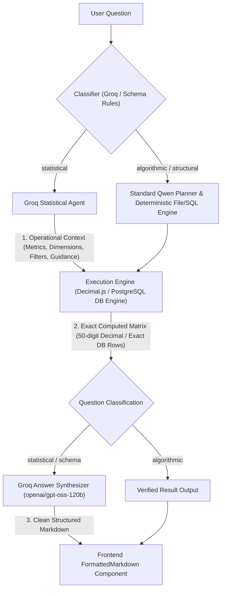

# Groq Analytical Engine Architecture

## 1. Executive Summary

Metis AI integrates **Groq** to deliver sub-second query classification, statistical contextualization, schema comprehension, and answer synthesis, while preserving Metis AI's core guarantee: **evidence before fluency**.

Generic LLMs frequently hallucinate metrics, percentages, or group totals when answering analytical questions directly. In Metis AI, **no LLM ever calculates numbers**. Instead:

1. **Groq** classifies the analytical intent and provides operational context (target metrics, dimensions, operations, and filters).
2. The **Deterministic Engine** (exact 50-digit precision Decimal.js arithmetic for files or verified read-only SQL queries on PostgreSQL) computes the numbers.
3. **Groq** receives the verified calculation matrix and formats a comprehensive, structured Markdown response with domain interpretations and key takeaways.
4. The **Frontend UI** (`FormattedMarkdown`) renders the synthesized tables, headings, callout boxes, and code blocks into an interactive interface.



---

## 2. Model & Runtime Configuration

- **Provider**: [Groq Cloud](https://groq.com/)
- **API Endpoint**: `https://api.groq.com/openai/v1/chat/completions`
- **Default Model**: `openai/gpt-oss-120b` (tested fallback: `qwen/qwen3.8-27b`)
- **API Key**: Configured via `GROQ_API_KEY` in `backend/.env`
- **Configuration Module**: [`backend/src/config.ts`](file:///Users/Yatharth/Documents/Project-Code/metis.ai/backend/src/config.ts)
- **Client Class**: [`GroqClient` in `backend/src/inference/groq.ts`](file:///Users/Yatharth/Documents/Project-Code/metis.ai/backend/src/inference/groq.ts)

### Environment Variables

```env
GROQ_API_KEY=gsk_...
GROQ_MODEL=openai/gpt-oss-120b
GROQ_BASE_URL=https://api.groq.com/openai/v1
```

---

## 3. Two-Tier Query Classification

Every query submitted to Metis AI is evaluated by `GroqClient.classify()`:

```typescript
export type QuestionClassification = "statistical" | "algorithmic";

export interface ClassificationResult {
  classification: QuestionClassification;
  reason: string;
}
```

### Classification Routing Rules

| Classification  | Trigger Criteria                                                                                                                                                        | Routing Behavior                                                                                                                                                      |
| :-------------- | :---------------------------------------------------------------------------------------------------------------------------------------------------------------------- | :-------------------------------------------------------------------------------------------------------------------------------------------------------------------- |
| **Algorithmic** | Schema inquiries, column names, table relationships, row lookups, simple record counts, filter queries.                                                                 | Routes directly to the standard deterministic engine or local Qwen query planner.                                                                                     |
| **Statistical** | Means, medians, modes, standard deviations, variances, sample skewness, distributions, normality assessments, Pearson correlations, quantiles, trends, and comparisons. | Engages Groq for pre-computation contextualization, executes the multi-column statistical engine, and routes computed results to Groq for post-computation synthesis. |

---

## 4. Where and How Groq is Used

### A. Pre-Execution Contextualization (`contextualizeStatisticalQuery`)

Before computation begins, Groq analyzes the user's question against dataset columns and sample records to extract operational metadata:

- **Metrics**: Numerical columns targeted for calculation (e.g. `["CGPA", "IQ"]`).
- **Dimensions**: Categorical grouping attributes (e.g. `["region", "Placement"]`).
- **Operations**: Identified operations (e.g. `["mean", "median", "stddev", "skewness", "normality"]`).
- **Filters**: Extraction of column/operator/value filters.
- **Guidance**: High-level execution directives passed to the planner or computation engine.

```typescript
const context = await groq.contextualizeStatisticalQuery({
  question: "Is the data distribution is normalised or not?",
  columns: data.columns,
  sampleData: data.rows.slice(0, 3),
});
```

### B. Deterministic Mathematical Computation (The Truth Engine)

When the query is classified as statistical, Metis AI's computation engine executes verified mathematical algorithms across all matching records using **Decimal.js** (50-digit exact precision arithmetic):

1. **Normality & Distribution Assessment**:
   - Calculates sample mean ($\mu$), median, variance ($s^2$), and sample standard deviation ($s$).
   - Calculates **Fisher-Pearson standardized third moment sample skewness** ($g_1$):
     $$g_1 = \frac{n}{(n-1)(n-2)} \sum_{i=1}^n \left(\frac{x_i - \bar{x}}{s}\right)^3$$
   - Evaluates normality criteria:
     - Approximate normality: $|g_1| < 0.5$ and $\frac{|\mu - \text{median}|}{s} < 0.2$.
     - Positive/negative tail asymmetry: $g_1 \ge 0.5$ (right-skewed) or $g_1 \le -0.5$ (left-skewed).
2. **Descriptive Statistics**:
   - Computes $N$, minimum, maximum, mean, median, mode, variance, standard deviation, 25th percentile ($Q_1$), 75th percentile ($Q_3$), and Interquartile Range ($IQR = Q_3 - Q_1$).
3. **Pearson Correlation**:
   - For all numeric variable pairs or named columns:
     $$r = \frac{\sum_{i=1}^n (x_i - \bar{x})(y_i - \bar{y})}{\sqrt{\sum_{i=1}^n (x_i - \bar{x})^2 \sum_{i=1}^n (y_i - \bar{y})^2}}$$
   - Classifies strength: $|r| \ge 0.7$ (strong), $0.4 \le |r| < 0.7$ (moderate), $0.2 \le |r| < 0.4$ (weak).

### C. Post-Execution Answer Synthesis (`synthesizeStatisticalAnswer`)

Once the calculation engine outputs the exact result columns and rows, Groq is called with a strict system prompt:

> **System Prompt Constraints**:
>
> 1. Strictly adhere to the supplied calculated numbers. Never invent, alter, or hallucinate metrics, totals, or percentages.
> 2. Highlight key takeaways, group breakdowns, or distributions clearly.
> 3. Use Markdown formatting (tables, bold highlights, bullet points).
> 4. Keep the explanation lucid, focused, and directly answering the question.

All Unicode non-breaking hyphens (`\u2010`–`\u2015`, `\u2212`) and non-breaking spaces are normalized to ASCII hyphens and spaces before returning to prevent markdown formatting issues.

### D. Architectural Schema Synthesis (`synthesizeSchemaAnswer`)

For queries like _"Help me understand the tables, columns, and relationships in my data."_:

- **File Analysis** ([`backend/src/files/analysis.ts`](file:///Users/Yatharth/Documents/Project-Code/metis.ai/backend/src/files/analysis.ts)):
  - Profiles observed types (integer, decimal, text, boolean).
  - Detects unique identifier candidates (columns with 100% unique non-null values).
  - Detects foreign reference columns (ending in `_id` or matching parent entities).
  - Distinguishes continuous metrics from categorical dimensions.
- **Database Analysis** ([`backend/src/analysis/conversations.ts`](file:///Users/Yatharth/Documents/Project-Code/metis.ai/backend/src/analysis/conversations.ts) & [`backend/src/analysis/orchestrator.ts`](file:///Users/Yatharth/Documents/Project-Code/metis.ai/backend/src/analysis/orchestrator.ts)):
  - Maps to `schema_overview` intent.
  - Queries authorized schema tables without violating AST safety policies.
  - Derives join relationships and foreign keys via `generateSchemaConstellation`.
- **Groq Synthesis**:
  - Synthesizes a structured overview:
    1. Tables Overview (names, roles, row counts).
    2. Columns & Data Types (metrics vs dimensions).
    3. Inferred Relationships & Foreign Keys.
    4. Recommendations for querying and exploration.

---

## 5. Frontend UI Markdown Rendering

To prevent raw ASCII text (e.g. `| col | col |`, `## Header`, `**bold**`) from appearing in the user interface, Metis AI uses a dedicated React Markdown renderer:

- **Component**: [`frontend/src/components/ui/formatted-markdown.tsx`](file:///Users/Yatharth/Documents/Project-Code/metis.ai/frontend/src/components/ui/formatted-markdown.tsx)
- **Styles**: Defined in [`frontend/src/app/globals.css`](file:///Users/Yatharth/Documents/Project-Code/metis.ai/frontend/src/app/globals.css)

### Capabilities:

1. **Responsive Markdown Tables**:
   - Parses markdown pipes and separators into styled HTML `<table>` elements with sticky header rows (`<th>`), padded cells (`<td>`), zebra hover effects, and horizontal scroll wrappers (`.markdown-table-scroll`).
2. **Headings**:
   - `##` and `###` render as styled semantic headings with proper margins and weights.
3. **Callout Cards**:
   - Blockquotes (`> ...`) render as alert boxes with left accent borders (`border-left: 4px solid #6366f1;`) and soft backgrounds.
4. **Code & Badges**:
   - Inline code (`` `code` ``) renders as rounded monospace pill badges.
   - Code blocks (` ``` `) render in dark monospace containers.
5. **Lists**:
   - Bulleted and numbered lists render with clean indentation and line height.

---

## 6. Offline Testing & CI Isolation

To ensure local and CI test suites run deterministically without internet dependencies or latency overhead:

- `GroqClient.isLive()` returns `false` when `process.env.NODE_ENV === "test"` unless explicitly enabled via `GROQ_LIVE_TEST=true`.
- In offline unit tests, mock classification and deterministic fallbacks are used.
- In development (`NODE_ENV=development`) and production, `isLive()` detects the configured `GROQ_API_KEY` and runs the full live Groq pipeline.

---

## 7. File Manifest & Key Source Pointers

| File                                                                                                                                                            | Purpose                                                                                                          |
| :-------------------------------------------------------------------------------------------------------------------------------------------------------------- | :--------------------------------------------------------------------------------------------------------------- |
| [`backend/src/inference/groq.ts`](file:///Users/Yatharth/Documents/Project-Code/metis.ai/backend/src/inference/groq.ts)                                         | Groq client: classification, contextualization, statistical answer synthesis, and schema synthesis.              |
| [`backend/src/files/analysis.ts`](file:///Users/Yatharth/Documents/Project-Code/metis.ai/backend/src/files/analysis.ts)                                         | File analysis engine: Decimal.js statistical computations, normality testing, correlation, and Groq integration. |
| [`backend/src/analysis/conversations.ts`](file:///Users/Yatharth/Documents/Project-Code/metis.ai/backend/src/analysis/conversations.ts)                         | Conversational follow-up engine: schema exploration resolution and policy validation.                            |
| [`backend/src/analysis/orchestrator.ts`](file:///Users/Yatharth/Documents/Project-Code/metis.ai/backend/src/analysis/orchestrator.ts)                           | Database orchestrator: AST execution, constellation generation, and Groq synthesis.                              |
| [`backend/src/analysis/planning.ts`](file:///Users/Yatharth/Documents/Project-Code/metis.ai/backend/src/analysis/planning.ts)                                   | Injects statistical guidance from Groq into the query generation prompt.                                         |
| [`frontend/src/components/ui/formatted-markdown.tsx`](file:///Users/Yatharth/Documents/Project-Code/metis.ai/frontend/src/components/ui/formatted-markdown.tsx) | Native React markdown renderer for structured tables, headings, callouts, and code.                              |
| [`frontend/src/components/file-answer.tsx`](file:///Users/Yatharth/Documents/Project-Code/metis.ai/frontend/src/components/file-answer.tsx)                     | File analysis presentation component using `FormattedMarkdown`.                                                  |
| [`frontend/src/components/workspace.tsx`](file:///Users/Yatharth/Documents/Project-Code/metis.ai/frontend/src/components/workspace.tsx)                         | Main analytical workspace using `FormattedMarkdown` for conversational outputs.                                  |
| [`frontend/src/app/globals.css`](file:///Users/Yatharth/Documents/Project-Code/metis.ai/frontend/src/app/globals.css)                                           | Design system CSS rules for markdown tables, callout blocks, and typography.                                     |
| [`backend/test/groq.test.ts`](file:///Users/Yatharth/Documents/Project-Code/metis.ai/backend/test/groq.test.ts)                                                 | Unit and live test suite verifying query classification, contextualization, and Groq API calls.                  |
