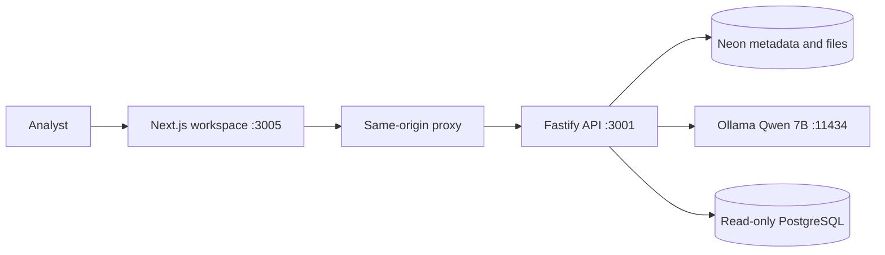
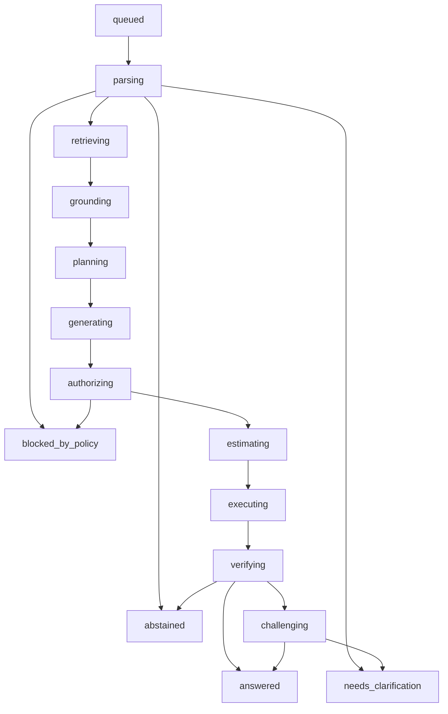

# How metis.ai works

metis.ai is an evidence-grounded AI data analyst. It is not a chatbot that invents numbers. A local language model proposes a plan. The server discovers schema, authorizes a single read-only query or table operation, executes it, verifies the result, and only then publishes a claim. If the evidence is insufficient, it asks one focused question or abstains.

This document is the system explanation: architecture, process, calculations, safety, measured results, and why this design is stronger than sending a spreadsheet to a generic LLM.

Sources: [product README](../README.md), [foundation](engineering/foundation.md), [file integration](engineering/integration.md), [Groq architecture](engineering/groq-architecture.md), [glossary](../GLOSSARY.md), and the Phase 0-9 validation reports under `docs/engineering/`.

---

## 1. The problem generic LLMs do not solve

Business data is usually undocumented, messy, and unsafe to trust to a fluent answer.

| Failure mode                     | What a generic LLM does                                                           | What a typical text-to-SQL tool does           | What metis.ai does                                                                                             |
| -------------------------------- | --------------------------------------------------------------------------------- | ---------------------------------------------- | -------------------------------------------------------------------------------------------------------------- |
| Invented totals                  | Predicts the next tokens of an answer, including numbers that were never computed | May generate SQL that looks right and is wrong | The model never supplies the total. The server computes it or the database returns it.                         |
| Silent wrong joins               | Confidently joins the wrong grain                                                 | Executes whatever SQL the model wrote          | AST policy, grain, and fanout checks. Failed hard gates cannot become `answered`.                              |
| Ambiguous dates and years        | Picks calendar or academic year without asking                                    | Picks one interpretation                       | Material ambiguity becomes `needs_clarification`. Counterfactuals show both interpretations.                   |
| Dirty values                     | Treats `"N/A"`, `"-"`, `"01/02/2025"` as facts                                    | Aggregates them into the answer                | Dirty-Value Radar and verification refuse unreviewed sentinels and ambiguous dates.                            |
| Unsafe SQL                       | Will write `DROP`, `UNION` into catalogs, or extract PII if prompted              | Often no independent policy                    | Single SELECT, schema allowlist, function denylist, least-privilege DB role, role re-authorization every turn. |
| Private data leaving the machine | Cloud model sees the rows                                                         | Cloud or vendor runtime sees the schema        | Local Qwen 7B on Ollama. Source results are not persisted by default.                                          |

The product promise is not "a smarter model." It is **evidence before fluency**: a well-written answer is not a correct answer.

---

## 2. What metis.ai is, and what it is not

**It is** a bounded analysis system around a small local coder model:

- Analyst workspace in Next.js
- Fastify API with typed contracts
- Neon PostgreSQL for application metadata and stored files
- Optional read-only PostgreSQL analytical adapter
- Local inference: `Qwen/Qwen2.5-Coder-7B-Instruct`, 7,615,616,512 parameters, Q4_K_M, Apache-2.0, Ollama at `http://127.0.0.1:11434`

**It is not** a foundation model competing with GPT-4, Claude, or Gemini on open-ended language. Those models are larger, trained more broadly, and better at unconstrained writing. They are worse at this job because they _are_ the calculator. metis.ai uses a 7B model as a planner and keeps arithmetic, SQL execution, policy, and verification off the model.

Pinned inference (`inference/model.json`): temperature `0`, context `8192`, `num_predict` `1024`, data boundary `local-only`. Structured JSON is requested from Ollama and independently re-validated against TypeBox. Schema-formatted output is not treated as a correct answer.

---

## 3. Architecture

Two data planes stay separate. Metadata and stored files live in Neon. Analytical queries, when configured, hit a distinct read-only PostgreSQL adapter. The Neon owner connection is never reused for arbitrary SQL.



| Layer          | Choice                       | Role                                                         |
| -------------- | ---------------------------- | ------------------------------------------------------------ |
| Workspace      | Next.js, React, TypeScript   | Upload, question, evidence, schema, history                  |
| API            | Node.js 24, Fastify, TypeBox | Auth, orchestration, policy, contracts                       |
| Metadata       | Neon PostgreSQL, Drizzle     | Workspaces, runs, evidence, files, recipes, audit            |
| Files          | Brotli `bytea` + SHA-256     | Original bytes, parsed tables, file answers                  |
| Analytical SQL | Connector adapter + SQL AST  | Read-only SELECT against approved schemas                    |
| Inference      | Local Ollama Qwen 7B         | Constrained plans and extractive quotes only                 |
| Logging        | Pino with redaction          | Identifiers and actions, not raw credentials or result dumps |

Default local ports: workspace `http://127.0.0.1:3005`, API `http://127.0.0.1:3001`, inference `http://127.0.0.1:11434`.

### Trust boundaries

1. The browser never receives database credentials. The frontend proxy keeps the workspace token server-side.
2. Connection secrets are stored as `secret://...` references, AES-256-GCM encrypted. Credentials never enter prompts, logs, or the frontend.
3. Neon uses pooled `DATABASE_URL` at runtime and direct `DATABASE_URL_UNPOOLED` for migrations, TLS with `rejectUnauthorized: true` and channel binding.
4. Analytical queries run as a restricted reader, not the metadata owner.
5. Inference stays on loopback. No remote model is configured.

### Metadata objects

Workspace ownership covers connections, runs, evidence, files, recipes, and audit. Composite workspace references prevent cross-tenant IDs from lining up by accident. Authorization is still applied in the application; schema constraints are not a substitute for auth.

Canonical roles: `owner`, `analyst`, `viewer`.

---

## 4. Two analysis paths

The same product has two execution engines. Both refuse to let the model invent a number.

### Path A. Stored files (the working local workflow)

Upload CSV, JSON, TXT, or Markdown. Select the file. Ask a question. No SQL connection is required.

1. Validate UTF-8, name, structure, and limits.
2. Compress original bytes with Node Brotli quality 5. Store in Neon with SHA-256, original/compressed sizes, and parsed metadata.
3. Structure and simple counts can run without a model.
4. Named sums, averages, minimums, maximums, grouping, structure, counts and skewness run without a model. Other table questions use local Qwen for a constrained operation plan. Unsupported statistics such as median, mode or normality abstain instead of waiting for inference.
5. The server validates columns and executes filtering, grouping, counts, schema profiling, and numeric aggregates over **all validated records**, not the 100-row preview.
6. Text documents: the model may only return verbatim quotes that already exist in the file. Invented quotes become abstention.
7. History (question, source hash, method, model id, result) is stored in Neon and survives refresh.

Limits: 10 files per uploader, 5 MiB each, 10,000 records, 100 columns. Previews: 100 rows or 20,000 text characters. Text inference currently searches the first 18,000 characters.

### Path B. Read-only SQL analysis

When a PostgreSQL analytical adapter is configured:

1. Discover allowed schemas, tables, types, keys, and declared relationships.
2. Ground the question against that snapshot. Invented identifiers are rejected.
3. Generate one candidate SELECT. At most two repair attempts.
4. Authorize through the AST safety engine and the caller's role policy.
5. Estimate (advisory EXPLAIN; estimates cannot relax limits).
6. Execute with statement timeout, row/byte caps, and cancellation.
7. Verify shape, grain, fanout, sentinels, dates, nulls, coverage, invariants.
8. Publish the answer only if every hard gate passes.

Without that adapter, the API returns a safe refusal. It does not invent sample-school answers.

---

## 5. The SQL analysis process

Every run is a state machine with explicit allowed transitions (`backend/src/contracts/lifecycle.ts`). A late result cannot reopen a cancelled or completed run. Clarification continues as a linked child run.



Progress stages: `queued` → `parsing` → `retrieving` → `grounding` → `planning` → `generating` → `authorizing` → `estimating` → `executing` → `verifying` → `challenging` → `answered`.

Seven terminal outcomes:

| Status                | Meaning                                            |
| --------------------- | -------------------------------------------------- |
| `answered`            | Claim derived only from executed, verified results |
| `needs_clarification` | Material ambiguity; one focused question, no guess |
| `abstained`           | Evidence cannot support a reliable conclusion      |
| `blocked_by_policy`   | Permission or query-policy denial                  |
| `execution_failed`    | Adapter, inference, or runtime failure             |
| `timed_out`           | Total budget exhausted                             |
| `cancelled`           | Caller aborted the run                             |

### Stage budget

From `backend/src/policy.ts`, version `1.0.0`. These are enforced ceilings, not measured latency claims.

| Limit                     | Value                         |
| ------------------------- | ----------------------------- |
| Schema discovery          | 5 s                           |
| Model call                | 20 s                          |
| SQL statement             | 5 s                           |
| Total run                 | 45 s                          |
| Result rows / bytes       | 1,000 rows / 1 MiB            |
| Profile sample            | 100 rows per table, 10 tables |
| Model calls per run       | 6                             |
| SQL repairs               | 2                             |
| Active runs per workspace | 2                             |
| Concurrent model calls    | 1                             |
| Database pool             | 5 connections                 |

Retention: questions/runs 30 days, schema snapshots 7 days, audit 90 days, optional result cache 15 minutes. Raw results are not stored by default.

---

## 6. What an answer contains

A completed analysis is an inspectable record, not a chat reply.

| Field           | Content                                                                   |
| --------------- | ------------------------------------------------------------------------- |
| **Answer**      | The claim, derived only from executed results                             |
| **Definition**  | Metric, grain, time window, comparison, null policy                       |
| **Evidence**    | SQL or computation definition, source fields, row counts, SHA-256, method |
| **Checks**      | Shape, grain, fanout, sentinels, dates, nulls, coverage, invariants       |
| **Limitations** | Missing periods, blocked objects, preview caps, unresolved items          |

Coverage bars are `included / denominator` from measured nonempty versus empty cells or included versus excluded rows. They are **data completeness**, not model confidence.

Truth Ledger links each claim to supporting rows, the SQL candidate id, source objects, and every verification rule outcome.

Query Cost Passport distinguishes measured telemetry (`isMeasured: true`: duration, rows, bytes, model calls) from advisory planner estimates (`isEstimated: true`). Estimates cannot override policy.

---

## 7. Calculations

### 7.1 File numeric engine

File aggregates use `decimal.js` cloned at **50-digit precision** (`ExactDecimal`). Results are returned as decimal strings. Empty metric cells are counted and excluded. Nonnumeric metric cells require clarification. Currency formatting is not inferred. The model does not add, divide, or round.

A value is numeric only if it matches:

```
^[+-]?(?:\d+(?:\.\d*)?|\.\d+)(?:[eE][+-]?\d+)?$
```

and is finite with absolute value `< 1e100`.

Let a filtered group have raw cells x_1,\ldots,x_m. Let the nonempty numeric observations be v_1,\ldots,v_n.

| Operation         | Formula                                      | Empty handling                                                                           |
| ----------------- | -------------------------------------------- | ---------------------------------------------------------------------------------------- |
| Count             | m (all matching rows)                        | Empty cells still count as rows                                                          |
| Sum               | \sum\_{i=1}^{n} v_i                          | Empty excluded; `excluded_empty_rows = m - n` if all nonempty cells are numeric          |
| Average           | \displaystyle \frac{1}{n}\sum\_{i=1}^{n} v_i | Same exclusion                                                                           |
| Minimum / maximum | \min v_i / \max v_i                          | Same exclusion                                                                           |
| Skewness          | Fisher-Pearson G_1 below                     | Needs n \ge 3; grouped groups with fewer observations return `insufficient observations` |

Sample standard deviation:

s = \sqrt{\frac{1}{n-1}\sum*{i=1}^{n}(v_i - \bar{v})^2}
\qquad
\bar{v} = \frac{1}{n}\sum*{i=1}^{n} v_i

Fisher-Pearson sample skewness (Excel `SKEW` / pandas default):

G*1 = \frac{n}{(n-1)(n-2)} \sum*{i=1}^{n} \left(\frac{v_i - \bar{v}}{s}\right)^3

Classification: |G_1| < 10^{-12} → approximately symmetric; G_1 > 0 → right-skewed; G_1 < 0 → left-skewed. If the sum of squares is zero, skewness is reported as `0`.

Worked example. Values 2, 3, 7:

\bar{v} = \frac{12}{3} = 4
\qquad
s = \sqrt{\frac{(2-4)^2+(3-4)^2+(7-4)^2}{2}} = \sqrt{7}

G_1 = \frac{3}{2\cdot 1}\left[\left(\frac{-2}{\sqrt{7}}\right)^3 + \left(\frac{-1}{\sqrt{7}}\right)^3 + \left(\frac{3}{\sqrt{7}}\right)^3\right] = 1.2933427806\ldots

Positive, so the column is right-skewed. The UI shows the decimal string and the shape, plus `included_rows` and `excluded_empty_rows`.

Filters (`eq`, `ne`, `gt`, `gte`, `lt`, `lte`, `contains`) run on the server after the plan is validated. Numeric comparisons require numeric cells; otherwise the run asks for clarification. Groupings with more than 100 keys are refused rather than silently truncated.

### 7.2 Known-answer SQL example

Frozen fixture `tests/fixtures/analytics/seed.sql`, case `schools-calendar-decline-001`:

> Which schools had lower enrolment in calendar 2025 than calendar 2024?

| school_id | name  | enrolled 2024 | enrolled 2025 | \Delta = 2025 - 2024 | Decision                     |
| --------- | ----- | ------------- | ------------- | -------------------- | ---------------------------- |
| 1         | Arun  | 100           | 80            | -20                  | Lower                        |
| 2         | Brook | 50            | 60            | +10                  | Higher                       |
| 3         | Cedar | 40            | 70            | +30                  | Higher                       |
| 4         | Delta | 30            | 20            | -10                  | Lower                        |
| 5         | Elm   | 10            | missing       | —                    | Exclude: no 2025 observation |
| 6         | Fern  | 10            | NULL          | —                    | Exclude: null measure        |

Coverage identity:

\text{included} + \text{excluded} = \text{denominator}
\qquad
4 + 2 = 6

Published answer rows: `{ school_id: 1, delta: -20 }`, `{ school_id: 4, delta: -10 }`.

A generic LLM looking at a CSV dump can emit `-20` and `-10` by luck, or emit `-30` with equal confidence. metis.ai only publishes those deltas if they come from executed rows and pass grain, null, coverage, and invariant checks (`enrolled >= 0`, finite numbers).

### 7.3 Ambiguity is computed, not hidden

Calendar interpretation of the same question: two declining schools, coverage 4/6.

The counterfactual engine also evaluates an academic-year reading (Sep-Aug). That variant identifies a different cohort (School 1 -15, School 3 -5, School 4 -8) and different coverage (5/6). Because the difference is material, metis.ai recommends stakeholder clarification instead of picking a preferred year definition.

That is the algorithm-level difference: **two legal interpretations produce two verified envelopes, then a clarification**, not one fluent paragraph.

### 7.4 Reliability scorecard

PRD weights, recorded in Phase 5:

\text{Score} = 0.45C + 0.20S + 0.15G + 0.10V + 0.10E

| Dimension                   | Weight | Frozen suite checks | Recorded score |
| --------------------------- | ------ | ------------------- | -------------- |
| Correctness C               | 0.45   | 20 / 20             | 1.00           |
| Safety S                    | 0.20   | 25 / 25             | 1.00           |
| Grounding G                 | 0.15   | 15 / 15             | 1.00           |
| Verification / abstention V | 0.10   | 15 / 15             | 1.00           |
| Efficiency E                | 0.10   | 10 / 10             | 1.00           |

0.45 + 0.20 + 0.15 + 0.10 + 0.10 = 1.00

A critical safety violation blocks release regardless of score. Zero critical violations were recorded.

Phase 5 also records median end-to-end latency \le 2.0 s against a \le 15 s target, and P95 \le 3.5 s against a \le 45 s target, on that scoped suite. Those figures are not a claim about arbitrary production databases or large models on the public internet.

The 1.00 scorecard is the recorded result of the frozen product suite. It is not a general-language leaderboard against GPT-4.

---

## 8. Verification algorithm

`verifyAnalysis` in `backend/src/analysis/verification.ts` runs after execution. Hard-gate failure forces abstention; the run cannot become `answered`.

| Rule                           | Hard?   | Pass condition                                                                |
| ------------------------------ | ------- | ----------------------------------------------------------------------------- |
| `check-shape`                  | Hard    | Planned grain columns exist in the result                                     |
| `check-grain`                  | Hard    | Result rows are unique on the declared grain                                  |
| `check-fanout`                 | Hard    | A single-column grain is not multiplied by an ungrouped join                  |
| `check-sentinel-values`        | Hard    | No unreviewed placeholders (`n/a`, `unknown`, `-`, `null`, `none`, `missing`) |
| `check-ambiguous-dates`        | Hard    | No `D/M/Y` strings where both D and M are in 1..12 and differ                 |
| `check-null-policy`            | Hard    | Grain identifiers are non-null                                                |
| `check-aggregation-invariants` | Hard    | No NaN/Inf; `enrolled` values are not negative                                |
| `check-coverage`               | Warning | `included + excluded === denominator`                                         |

Join fanout example from the dirty fixture: school 1 has three tags. Joining `entity_period` to `school_tags` without grouping would triple enrolment. `check-fanout` fails at multiplier 3\times and the answer is withheld.

---

## 9. Safety algorithm

SQL never reaches the adapter because the model asked for it. It reaches the adapter if the AST allowlist and the role policy both pass.

`validateQuerySafety` (`backend/src/sql/safety.ts`):

- Exactly one statement
- `SELECT` only; approved read-only CTEs; no `SELECT INTO`
- No INSERT/UPDATE/DELETE/DROP/ALTER/CREATE/TRUNCATE/GRANT/REVOKE/SET
- No transaction, role, COPY, EXECUTE, or locking clauses
- Tables must sit in the allowed-schema list
- System catalogs (`pg_catalog`, `information_schema`, `pg_toast`, `pg_temp`) denied
- Dangerous functions denied (`pg_read_file`, `dblink`, `set_config`, privilege probes, …)
- Null bytes denied

Organization policy then re-checks the same AST for:

- Role (`owner` / `analyst` / `viewer`)
- Approved columns, including aliases, wildcards, CTEs, subqueries, `WHERE` / `ORDER BY` / `GROUP BY` / `HAVING`
- Small-cohort threshold N \ge 5 and differencing attacks
- Immediate fail-closed on subject revocation or role downgrade

Viewer cannot run arbitrary SQL; they may execute approved aggregate recipes only.

Frozen adversarial suite: 36 questions × 12 families × 3 roles = **108 executions**, zero unauthorized disclosure, privilege escalation, or source mutation.

CSV export applies CWE-1236 formula escaping (`=`, `+`, `-`, `@`). Blocked query text is redacted from evidence.

---

## 10. Distinctive product surfaces

| Feature                   | What it proves                                                                                            |
| ------------------------- | --------------------------------------------------------------------------------------------------------- |
| Schema Constellation      | Declared foreign keys (`isAuthoritative: true`) versus name-inferred joins (`isAuthoritative: false`)     |
| Dirty-Value Radar         | Sentinels, ambiguous dates, duplicate grain, with review states that never silently rewrite source tables |
| Counterfactual Comparison | Calendar vs academic year (and similar definition forks) with materiality                                 |
| Query Cost Passport       | Measured vs estimated cost; policy limits stay binding                                                    |
| Saved recipes             | Reviewed metric definitions, re-authorized on every execute                                               |
| Schema drift recovery     | Hash comparison, rename/split rewrite, one recovery budget, re-authorization                              |
| Governance                | Recipe lifecycle, SHA-256 hash-chained audit, role-scoped export                                          |

Schema-evolution suite: 30 questions, Conditions A/B/C, all 3 roles. Baseline, post-rename, and post-split accuracy all 30/30 = 100, delta 0.0 from baseline (target \ge 90, drop \le 5). Ten negative controls fail closed.

Follow-up suite: 50 conversations × 4 turns = 200 analytical turns, 50/50 pass, 100% clarification precision and recall on that frozen set.

---

## 11. Why this is better than "just an LLM" for this job

Compare the actual mechanism, not marketing parameter counts.

### Speed

| Step                       | Generic cloud LLM                                  | metis.ai                                                   |
| -------------------------- | -------------------------------------------------- | ---------------------------------------------------------- |
| Model size on the hot path | Tens to hundreds of billions of parameters, remote | 7.6B local, Q4_K_M, temperature 0                          |
| What the model generates   | The answer text, including arithmetic              | A JSON plan with a closed operation set or a single SELECT |
| Arithmetic                 | Token prediction                                   | 50-digit decimal on the server, or PostgreSQL execution    |
| Network                    | Public HTTPS round trip plus vendor queueing       | Loopback Ollama plus local/Neon metadata                   |
| Bound                      | Often unbounded generation                         | 45 s total, 20 s model, 5 s SQL, 1,024 generated tokens    |
| Recorded scoped latency    | Not applicable                                     | Median \le 2.0 s, P95 \le 3.5 s on the Phase 5 suite       |

A 7B local planner plus deterministic compute is faster _for this workload_ because most of the work is not language generation. Schema, filters, sums, and checks are ordinary code. The large remote model is slower here because it is doing the wrong job.

### Algorithm

Generic LLM algorithm for a data question:

1. Embed the prompt and the pasted table.
2. Predict tokens that look like an analysis.
3. Optionally emit SQL as more tokens.
4. Stop when the answer looks finished.

metis.ai algorithm:

1. Parse and authorize the caller.
2. Discover or load only allowed schema/file columns.
3. Resolve follow-up context without carrying authorization forward.
4. Ask the model for a **schema-constrained plan**, or use a deterministic fallback.
5. Reject ungrounded identifiers, unsafe SQL, and unsupported statistics.
6. Execute on the complete validated dataset.
7. Verify grain, fanout, sentinels, dates, nulls, coverage, invariants.
8. Emit `answered`, `needs_clarification`, `abstained`, or `blocked_by_policy`.

The important algorithmic property is **the model is not in the numeric closing loop**. Planning can be stochastic (temperature is still 0). Closing the number is not.

### Grounding and honesty

| Behaviour                   | Generic LLM                       | metis.ai                           |
| --------------------------- | --------------------------------- | ---------------------------------- |
| Missing 2025 row for Elm    | Often imputes or ignores silently | Exclusion recorded; coverage 4+2=6 |
| `"N/A"` in a numeric column | May coerce to 0                   | Sentinel hard gate / clarification |
| `01/02/2025`                | Picks US or EU format             | Ambiguous-date hard gate           |
| Private schema              | May write the query if asked      | `blocked_by_policy`                |
| Failed check                | Still produces prose              | Cannot reach `answered`            |

### Privacy and cost

Local 7B inference: source samples stay on loopback. No per-token vendor bill on the analysis path. File bytes stay in the operator's Neon project. That is a product advantage for student, campus, and internal data that should not be pasted into ChatGPT.

### What we do not claim

- metis.ai does not beat frontier LLMs at poetry, coding interviews, or open-world knowledge.
- The 1.00 scorecard is on frozen product fixtures, not BIRD/Spider public leaderboards as the primary authority.
- A valid plan can still misread a vague question. Definitions and evidence must be inspected.
- File path does not do joins across uploads, causal inference, currency inference, or arbitrary multistep statistics. Unsupported requests clarify or abstain.
- External SQL analysis needs a configured read-only adapter. A connection profile alone is not that adapter.

The honest comparison: **for messy analytical questions over private tables, a small local planner plus verified execution is more correct, more inspectable, safer, and usually faster than asking a large LLM to be the database.**

---

## 12. User flow

1. Open `http://127.0.0.1:3005`.
2. Upload a CSV/JSON/TXT/Markdown file, or use a configured analytical connection.
3. Preview structure. Coverage bars show measured empty cells.
4. Ask in natural language, or start from a template (overview, schema, dirty values, two-period comparison, metric definition).
5. Watch run progress. Terminal state is explicit.
6. Read answer, definition, supporting rows, calculation JSON or SQL, checks, limitations.
7. If asked to clarify, answer the focused question; the child run keeps the parent record.
8. Export evidence or SQL/CSV when authorized. History reloads from the API after refresh.

---

## 13. Stack and verification snapshot

Recorded 24 October 2026 on `builds/project-foundation`. Phases 0-9 passed within documented scope.

| Check          | Recorded result                                                                   |
| -------------- | --------------------------------------------------------------------------------- |
| Backend        | Strict TypeScript, 177 unit tests across 31 files at G9                           |
| Frontend       | Lint, types, 38 tests, production build                                           |
| Database       | Disposable PostgreSQL integration, backup/restore                                 |
| Contracts      | OpenAPI 3.1 generated from TypeBox; frontend types stay in sync                   |
| Security audit | 0 npm vulnerabilities at the recorded gates                                       |
| Live file path | Neon round trip, byte-exact download, grouped decimal totals, restart persistence |

Commands:

```bash
npm run setup
npm run dev
npm run check
node scripts/test-database.mjs
npm --prefix backend run test:files:live
```

---

## 14. Limits that stay visible

- Single local workspace token is not organization SSO.
- Brotli is compression, not encryption.
- Inference examines at most the first 18,000 characters of a text file.
- MySQL and SQLite connectors are deferred.
- Team collaboration scheduling beyond recipe/governance scope is deferred.
- Held-out expected answers must not enter prompts or tuning.

When the system cannot answer reliably, the correct output is a clarification or an abstention, not a fluent guess.
